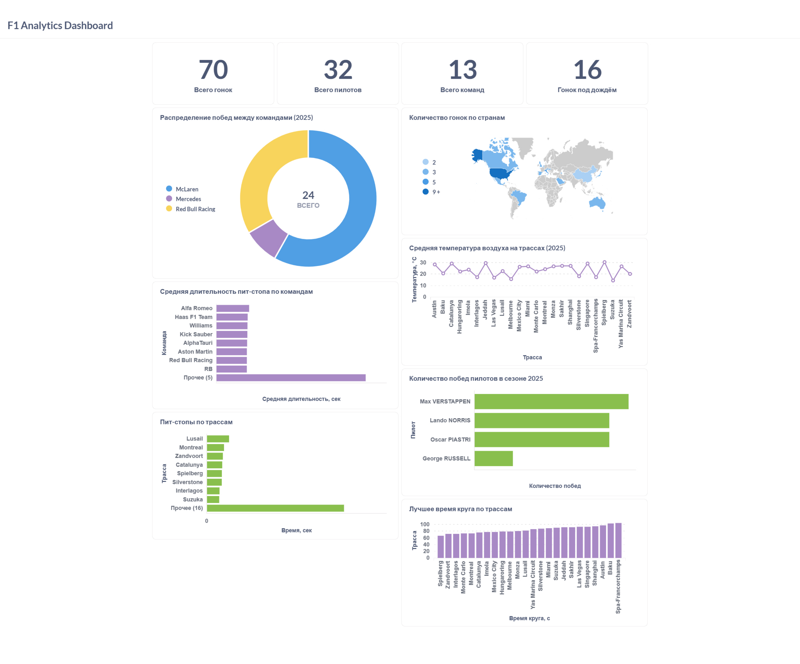

# 🏎️ F1 Data Pipeline

**Автор:** Дарья Байгина

ETL/ELT-пайплайн для автоматизированного сбора, хранения и аналитической обработки данных чемпионата Formula 1 из OpenF1 API.

Проект демонстрирует разработку пайплайна данных с использованием Python, Apache Airflow, PostgreSQL и dbt — от получения данных из API до формирования аналитических витрин и автоматизированных проверок Data Quality.

## 📌 Возможности проекта

- Получение данных из OpenF1 API.
- Историческая и инкрементальная загрузка.
- Оркестрация ETL через Apache Airflow.
- Хранение данных в PostgreSQL.
- UPSERT и транзакционная загрузка данных.
- SQL-трансформации и аналитические витрины в dbt.
- Автоматические проверки Data Quality.
- Визуализация аналитических данных через Metabase.
- Локальное развёртывание через Docker Compose.

## 🏗️ Архитектура

```text
                 OpenF1 API
                     |
                     v
           Apache Airflow + Python
             ETL / Incremental
                     |
                     v
                PostgreSQL
                 RAW Layer
                (6 таблиц)
                     |
                     v
                    dbt
           +---------+---------+
           |         |         |
           v         v         v
        Staging   Data Marts   Data Quality
        6 views   6 tables     2 models
           |         |         |
           +---------+---------+
                     |
                     v
              dbt Data Tests
                     |
                     v
                  Metabase
              BI Visualization
```

Apache Airflow управляет загрузкой данных и автоматически запускает dbt после успешного завершения ETL.

Metabase используется для визуализации подготовленных данных и не является обязательным этапом выполнения пайплайна.

## 🛠️ Технологический стек

| Компонент | Технология |
|---|---|
| Язык | Python 3.10 |
| Источник | OpenF1 API |
| Оркестрация | Apache Airflow 2.8.2 |
| База данных | PostgreSQL 13 |
| SQL-трансформации | dbt-core 1.8.0 |
| Адаптер dbt | dbt-postgres 1.8.2 |
| Работа с PostgreSQL | psycopg2 |
| HTTP-запросы | requests |
| Визуализация | Metabase |
| Контейнеризация | Docker, Docker Compose |
| Контроль версий | Git, GitHub |

## ⚙️ ETL-пайплайн

Данные загружаются из OpenF1 API в шесть таблиц PostgreSQL:

- `sessions` — гоночные сессии;
- `drivers` — пилоты и команды;
- `laps` — времена кругов;
- `pit_stops` — пит-стопы;
- `weather` — погодные условия;
- `positions` — позиции пилотов.

### Инкрементальная загрузка

Реализованы два режима:

**1. Historical Backfill**

Первоначальная или повторная историческая загрузка выбранных сезонов.

Пример конфигурации ручного запуска:

```json
{
  "mode": "backfill",
  "years": [2023, 2024, 2025]
}
```

**2. Daily Incremental**

Регулярная загрузка данных за последние 14 дней.

Пайплайн получает список сессий за необходимые годы, выбирает недавно завершившиеся сессии и обновляет связанные с ними данные.

Такой подход позволяет не переобрабатывать всю историю при каждом ежедневном запуске.

Это инкрементальная обработка на уровне сессий, а не CDC на уровне отдельных строк. При простоях дольше 14 дней может потребоваться backfill.

### Загрузка в PostgreSQL

Для сохранения данных применяются:

- UPSERT для сессий и пилотов;
- `DELETE + INSERT` для замены данных выбранной сессии;
- пакетная вставка через `execute_values`;
- транзакции с откатом при ошибках;
- повторные попытки выполнения задач Airflow.

Повторная загрузка сессии заменяет её существующие записи, а не добавляет новый комплект строк.

Пустые наборы не удаляют ранее сохранённые данные.

## 🔄 Apache Airflow

Основной DAG: `f1_data_pipeline`.

DAG состоит из семи последовательных задач:

```text
load_sessions
      |
      v
load_drivers
      |
      v
load_laps
      |
      v
load_pit_stops
      |
      v
load_weather
      |
      v
load_positions
      |
      v
run_dbt
      |
      v
dbt build
```

### Автоматизация

Airflow обеспечивает:

- ежедневное расписание;
- ручной запуск исторической загрузки;
- управление зависимостями задач;
- повторные попытки при ошибках;
- логирование выполнения;
- автоматический запуск dbt;
- ограничение одновременных запусков DAG.

После завершения ETL задача `run_dbt` выполняет `dbt build`, обновляя аналитические модели и запуская проверки качества данных.

### Скриншот Airflow DAG

<details>
<summary>Посмотреть DAG Airflow</summary>


</details>

## 🗄️ Хранение и обработка данных

### RAW Layer

PostgreSQL хранит исходные данные в шести таблицах.

Для основных сущностей предусмотрены первичные ключи и индексы. Загрузка организована с использованием транзакций.

### Staging Layer

Шесть SQL-представлений:

- `stg_sessions`
- `stg_drivers`
- `stg_laps`
- `stg_pit_stops`
- `stg_positions`
- `stg_weather`

Staging-модели подготавливают исходные данные для аналитических расчётов: очищают, фильтруют и преобразуют записи.

### Data Marts

Реализованы шесть аналитических витрин:

| Витрина | Назначение |
|---|---|
| `mart_race_summary` | Сводные показатели по гонкам |
| `mart_driver_performance` | Анализ выступлений пилотов |
| `mart_team_comparison` | Сравнение команд |
| `mart_fastest_laps` | Анализ лучших кругов |
| `mart_pit_stop_impact` | Анализ пит-стопов |
| `mart_weather_analysis` | Анализ погодных условий |

Витрины создаются с помощью SQL-моделей dbt и обновляются после успешной загрузки данных.

## ✅ Data Quality

Реализована система автоматизированных проверок качества данных.

**41 тест dbt**, включая:

- `not_null` — отсутствие пустых значений;
- `unique` — уникальность идентификаторов;
- `relationships` — проверка связей между моделями;
- `accepted_values` — проверка допустимых категорий;
- пользовательский SQL-тест составной уникальности кругов.

Для кругов проверяется комбинация:

```text
session_key + driver_number + lap_number
```

Дополнительно реализованы две модели мониторинга аномалий:

- `dq_lap_anomalies`
- `dq_weather_anomalies`

Они сохраняют записи, соответствующие заданным правилам выявления аномалий. Такие записи требуют дополнительной интерпретации и не обязательно являются ошибками данных.

Основные тесты выполняются на подготовленных dbt-моделях.

## 🧪 Тестирование пайплайна

18 ноября 2026 года проведено локальное тестирование проекта.

### Инкрементальная загрузка

OpenF1 API вернул 131 сессию за 2026 год.

Из них пайплайн выбрал и обработал 5 сессий за установленное 14-дневное окно.

### Повторная загрузка

Проверена повторная загрузка кругов для сессии `10033`.

Результаты:

| Показатель | Значение |
|---|---:|
| Строк до повторной загрузки | 559 |
| Строк после повторной загрузки | 559 |
| Уникальных кругов | 559 |
| Дубликатов по логическому ключу | 0 |

### Проверка dbt

Успешно выполнены:

- 6 staging-моделей;
- 6 аналитических витрин;
- 2 модели Data Quality;
- 41 тест качества данных.

Результат `dbt build`:

```text
PASS=55
WARN=0
ERROR=0
SKIP=0
TOTAL=55
```

### Проверка Airflow

Выполнен полный ручной запуск DAG.

Все 7 задач завершились со статусом `success`, включая автоматический запуск dbt.

Проверки подтверждают работоспособность протестированного сценария в локальном окружении.

## 🚀 Локальный запуск

### 1. Клонирование репозитория

```bash
git clone https://github.com/ddaria9876543/f1-data-pipeline.git
cd f1-data-pipeline
```

### 2. Настройка переменных окружения

Создать `.env` из шаблона.

PowerShell:

```powershell
Copy-Item .env_template .env
```

Указать необходимые параметры PostgreSQL:

```env
POSTGRES_PUBLICIST_USER=postgres
POSTGRES_PUBLICIST_PASSWORD=your_password
POSTGRES_PUBLICIST_DB=f1_raw
```

Не публикуйте `.env` и реальные пароли в GitHub.

### 3. Запуск Docker Compose

```powershell
docker compose config --quiet
docker compose up -d --build
docker compose ps
```

При первом запуске PostgreSQL создаёт исходные таблицы из SQL-скриптов в `postgres/init/`.

Скрипты инициализации автоматически выполняются только при создании пустого тома PostgreSQL.

Не используйте `docker compose down -v` без резервной копии данных.

### 4. Проверка Airflow

Веб-интерфейс:

http://localhost:8082

Основной DAG:

`f1_data_pipeline`

Проверка задач:

```powershell
docker compose exec airflow-scheduler airflow tasks list f1_data_pipeline
```

Проверка ошибок импорта:

```powershell
docker compose exec airflow-scheduler airflow dags list-import-errors
```

Для ручного запуска используйте интерфейс Airflow или CLI.

### 5. Проверка dbt

Проверка подключения:

```powershell
docker compose exec dbt dbt debug
```

Построение моделей и запуск тестов:

```powershell
docker compose exec dbt dbt build
```

При штатном выполнении DAG dbt запускается автоматически после успешного завершения ETL.

## 📊 Визуализация — Metabase

Для визуализации аналитических витрин используется Metabase.

Дашборд позволяет анализировать:

- результаты гонок;
- показатели пилотов и команд;
- распределение побед;
- продолжительность пит-стопов;
- лучшие времена круга;
- погодные условия;
- географию гонок.

### Скриншот дашборда

<details>
<summary>Посмотреть дашборд Metabase</summary>



</details>

Локальный интерфейс Metabase:

http://localhost:3001

Для подключения к PostgreSQL внутри Docker используется:

- Host: `postgres-publisher`
- Port: `5432`
- Database: `f1_raw`
- Schema: `analytics`

Скриншот демонстрирует ранее созданную визуализацию. Её соответствие текущему состоянию обновлённых витрин отдельно не проверялось.

## 📁 Структура проекта

```text
f1-data-pipeline/
├── airflow/
│   └── dags/
│       ├── extractor.py
│       ├── loader.py
│       └── f1_pipeline_dag.py
│
├── postgres/
│   └── init/
│       └── 01_init_schema.sql
│
├── dbt/
│   └── f1/
│       ├── dbt_project.yml
│       ├── models/
│       │   ├── staging/
│       │   ├── marts/
│       │   └── data_quality/
│       └── tests/
│           └── test_unique_laps.sql
│
├── images/
│   ├── dashboard.png
│   └── airflow_dag.png
│
├── metabase/
├── .dbt_template/
│   └── profiles.yml
│
├── .env_template
├── .gitignore
├── Dockerfile
├── docker-compose.yaml
├── requirements.txt
└── README.md
```

## 🔧 Дальнейшие улучшения

- Реализация устойчивого watermark для инкрементальной загрузки.
- Контроль полноты данных из OpenF1 API.
- Дополнительные проверки Data Quality на RAW-слое.
- Разделение служебных данных Airflow и данных Формулы-1.
- Автоматические Python-тесты и CI.
- Уточнение критериев аномалий и расчётов аналитических показателей.
